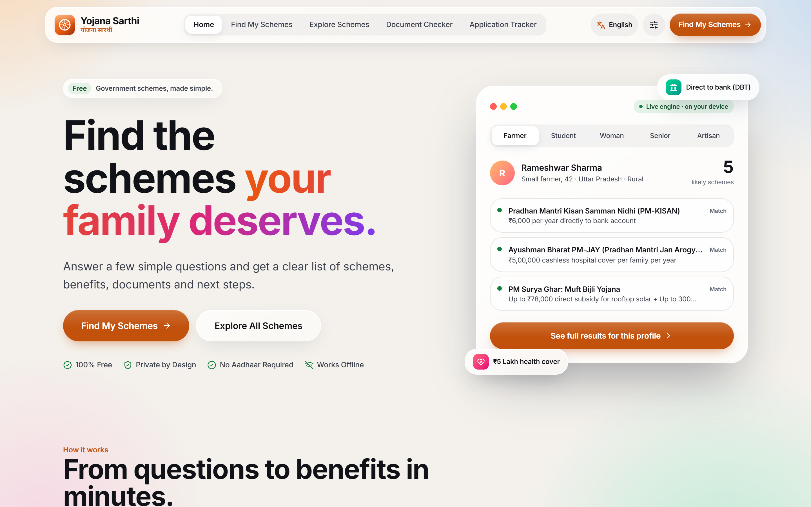
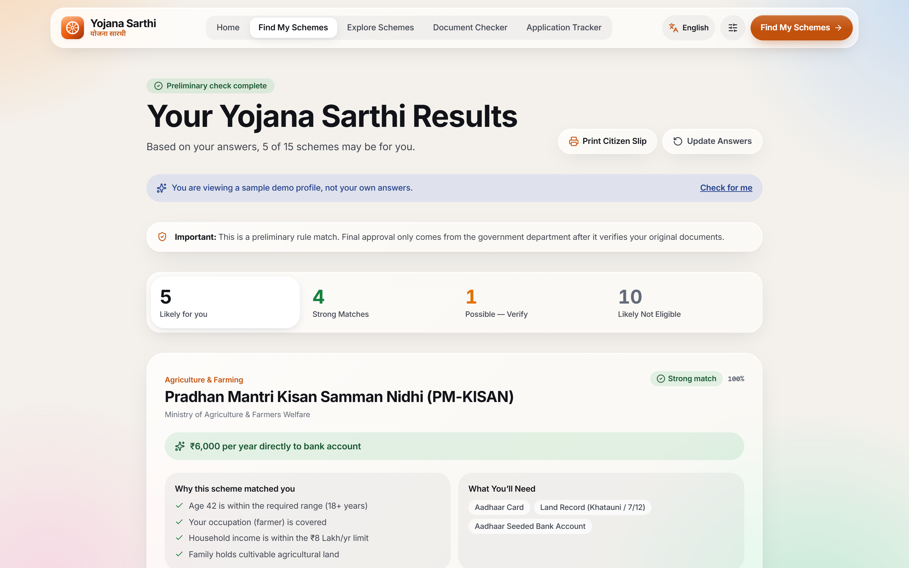
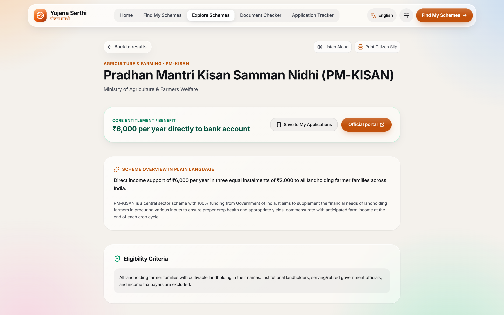
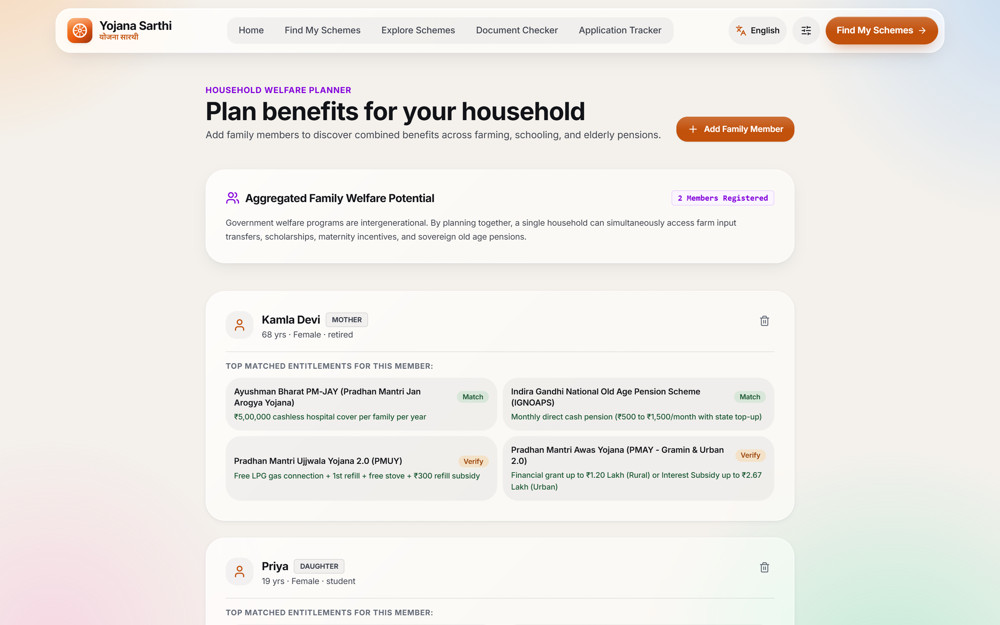
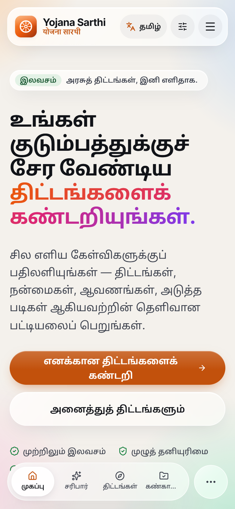
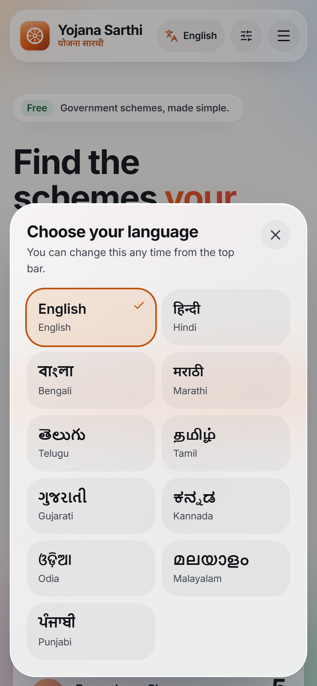
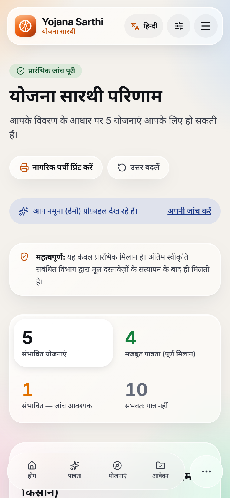
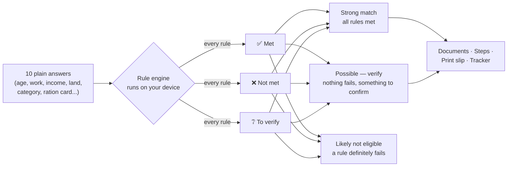
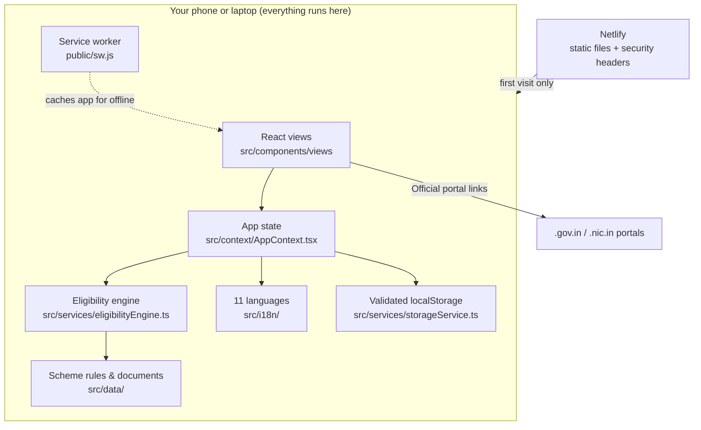

<div align="center">


# Yojana Sarthi · योजना सारथी

**Find the government welfare schemes your family may qualify for, explained in plain words, in 11 Indian languages.**

Free · No login · No Aadhaar · Works offline · Nothing leaves your phone

[](https://yoajanasarthi.netlify.app)

[](https://github.com/theanshdhyani/Yojana-Sarthi/actions/workflows/ci.yml)


[**Try it in 60 seconds**](#try-it) · [Features](#features) · [How the engine decides](#engine) · [Languages](#languages) · [Privacy](#privacy) · [Run locally](#run-locally)

<br />



</div>

---

## 🧭 The problem

India runs hundreds of welfare schemes: cash for farmers, free hospital cover, pensions, housing grants, scholarships. Yet many eligible families never claim them, because:

- **The rules are scattered** across ministries and portals, and written in legal and bureaucratic language.
- **Information mostly reaches people in English or Hindi**, not the language they actually read.
- **Middlemen fill the gap.** They charge for "help" that should be free, and sometimes collect Aadhaar numbers, OTPs or bank details for fraud.

**Yojana Sarthi** (*"scheme guide"*) asks ten plain questions and shows which schemes are likely for you, *why*, what documents you need, and where to go. It needs no login, no Aadhaar and no phone number.

<a id="features"></a>

## ✨ What it does

<table>
  <tr>
    <td valign="top">
      
      <br /><b>Results with reasons.</b> Every scheme says <i>what matched</i>, <i>what failed</i> and <i>what to confirm at the office</i>. Nothing is a black box.
    </td>
    <td valign="top">
      
      <br /><b>Plain-language scheme pages.</b> Simple summary, read-aloud, documents, step-by-step application, common rejection reasons and the official <code>.gov.in</code> link.
    </td>
  </tr>
  <tr>
    <td valign="top">
      
      <br /><b>Family planner.</b> Checks each household member separately, so a grandmother's pension and a daughter's scholarship aren't missed.
    </td>
    <td valign="top" align="center">
      
      
      
      <br /><b>Built for the phone in your pocket.</b> Tamil, the language picker, and Hindi. Every language is tested down to a 320&nbsp;px screen.
    </td>
  </tr>
</table>

| | Feature | Details |
|---|---|---|
| 🎯 | **Eligibility check** | 10 questions → 15 central schemes, sorted into *Strong match*, *Possible — verify* and *Likely not eligible* |
| 🗣️ | **11 languages + voice** | Full interface and scheme content; read-aloud in the chosen language; simple-language mode |
| 📄 | **Document checker** | Readiness checklist with issuing office, fee, processing time and tips |
| 🖨️ | **Citizen slip** | A printable bilingual summary to carry to a CSC or Panchayat office |
| 📌 | **Application tracker** | Saves applications with a status timeline; reminds you of the next step |
| 👨‍👩‍👧 | **Family planner** | Per-member results for the whole household |
| 📍 | **Nearby help** | Kinds of help centres to visit, plus a link to the official CSC locator |
| 🛡️ | **Anti-scam guidance** | Official portals end in `.gov.in` / `.nic.in`; never pay middlemen; report fraud to 1930 |
| 📶 | **Works offline** | Installable PWA; after one visit, everything works without internet |
| ♿ | **Accessible** | Large text, high contrast, dark mode, reduced motion, keyboard navigation, screen-reader labels |

<a id="try-it"></a>

## ⏱️ Try it in 60 seconds

1. Open **[yoajanasarthi.netlify.app](https://yoajanasarthi.netlify.app)** on a phone or laptop.
2. On the home card, switch between **Farmer / Student / Woman / Senior / Artisan** to see results change live.
3. Tap **See full results for this profile**. Open any scheme to see *why* it matched.
4. Tap the **language button** in the top bar and pick **தமிழ்** or **বাংলা**. Everything, including the reasons, switches language.
5. Open **Family Mode** (menu → Family Mode) and add a 68-year-old mother. The old-age pension appears for her.
6. Turn on airplane mode and reload. The app still works.

<a id="engine"></a>

## 🧠 How the eligibility engine decides



Each scheme's rules live as data in [`src/data/schemesData.ts`](src/data/schemesData.ts). The engine in [`src/services/eligibilityEngine.ts`](src/services/eligibilityEngine.ts) checks every rule and resolves it to exactly one outcome:

| Outcome | Example | Effect |
|---|---|---|
| ✅ **Met** | Age 42 is within 18+ | Counts fully |
| ❌ **Not met** | Scheme is only for women | Scheme becomes *Likely not eligible* |
| ❔ **To verify** | Income bracket ₹2.5–5 L straddles a ₹3 L limit | Counts half; scheme becomes *Possible — verify* |

<details>
<summary><b>Design decisions that keep results honest</b> (click to expand)</summary>

- **Income brackets are compared as ranges, not single points.** A family is never rejected just because its bracket's upper end is above a limit.
- **Household-member schemes check the member.** For Sukanya Samriddhi, widow and old-age pensions and PMMVY, the engine checks the daughter's, widow's or elder's condition, not the age or gender of whoever fills in the form.
- **A missing answer is never a pass.** It becomes *to verify* with zero credit.
- **Conditions the form doesn't ask are never assumed.** PMAY requires "no pucca house" and Ujjwala requires "no existing LPG connection". These always appear under *Confirm at the office*, so those schemes are never shown as certain.
- **Official criteria, not convenient proxies.** NSAP pensions depend on BPL status, so the engine applies no invented rupee cap.
- **Results are always called preliminary.** Final approval comes only from the department after it verifies documents, and the app says so on every result.

All of these are covered by unit tests in [`eligibilityEngine.test.ts`](src/services/eligibilityEngine.test.ts).

</details>

<a id="languages"></a>

## 🌏 11 languages

| Language | Script | Status |
|---|---|---|
| English | Latin | ✅ Reviewed |
| हिन्दी Hindi | Devanagari | ✅ Reviewed |
| বাংলা Bengali · मराठी Marathi · తెలుగు Telugu · தமிழ் Tamil · ગુજરાતી Gujarati · ಕನ್ನಡ Kannada · ଓଡ଼ିଆ Odia · മലയാളം Malayalam · ਪੰਜਾਬੀ Punjabi | 8 scripts | 🟡 AI-drafted, awaiting native-speaker review (the app shows a notice) |

How it's built ([`src/i18n/`](src/i18n)):

- **Completeness is type-checked.** Every language file must contain every message key, or the build fails.
- **Fast first load.** English and Hindi ship with the app. Each other language (~70 kB) downloads only when chosen, then works offline.
- **The right font and voice.** Each script's Noto font loads on demand. Read-aloud uses a voice for that language, or tells the user none is installed.
- **Long words never break the layout.** This was tested in every language from 320 px phones to desktop.

<a id="privacy"></a>

## 🔒 Privacy & security

| | |
|---|---|
| **No backend, no accounts, no analytics** | Answers stay in the browser's `localStorage`, and can be exported or wiped from Settings |
| **Minimal data** | Never asks for Aadhaar, phone number, bank details or full name |
| **Validated storage** | Everything read back is checked; tampered or corrupt data is discarded, never rendered ([`storageService.ts`](src/services/storageService.ts)) |
| **Safe links** | Links built from data allow `https:` only, blocking `javascript:` injection ([`safeUrl.ts`](src/utils/safeUrl.ts)) |
| **Hardened headers** | Strict Content-Security-Policy, HSTS, `X-Frame-Options: DENY`, `nosniff`, locked-down `Permissions-Policy` ([`netlify.toml`](netlify.toml)) |
| **Clean supply chain** | 3 runtime dependencies; `npm audit` reports 0 vulnerabilities; no source maps in production |

## 🏗️ Architecture



<details>
<summary><b>Project structure</b></summary>

```
src/
  components/views/               one file per screen (home, questionnaire, results, family…)
  components/common/              header, mobile dock, language picker, toasts
  context/AppContext.tsx          app state, language loading, actions
  services/eligibilityEngine.ts   rule engine (+ tests)
  services/storageService.ts      validated local persistence (+ tests)
  services/speechService.ts       read-aloud with per-language voices
  data/schemesData.ts             15 schemes: rules, documents, steps, helplines
  data/documentsData.ts           12 documents: issuing office, fee, time
  data/statesAndDistricts.ts      all 28 states and 8 union territories
  i18n/messages/                  English and Hindi (bundled)
  i18n/locales/                   9 more languages, loaded on demand
  utils/                          safe URLs, local dates (+ tests)
public/sw.js                      offline service worker
netlify.toml                      deploy settings + security headers
.github/workflows/ci.yml          type-check, tests, build and audit on every push
```

</details>

## 🛠️ Tech stack

**React 19** · **TypeScript (strict)** · **Vite** · **Tailwind CSS 4** · **Vitest** · **Service Worker (PWA)** · **Netlify** · **GitHub Actions**

<a id="run-locally"></a>

## 💻 Run locally

Requires Node.js 22+.

```bash
git clone https://github.com/theanshdhyani/Yojana-Sarthi.git
cd Yojana-Sarthi
npm install
npm run dev        # http://localhost:3000
```

| Command | What it does |
|---|---|
| `npm test` | Unit tests: engine rules, storage validation, URL safety, dates |
| `npm run lint` | Strict type-check, which also checks every language is complete |
| `npm run build` | Production build in `dist/` |

## ⚠️ Limitations

We'd rather say these upfront:

- Covers **15 central schemes**; state schemes are not included yet.
- Scheme amounts and rates change. Always confirm on the official portal linked from each scheme.
- The help-centre directory contains **sample entries only**; the app links to the official CSC locator for real centres.
- Nine of the translations are **AI-drafted** and need review by fluent speakers. Long scheme details (application steps, rejection reasons) are still English/Hindi only.
- **Urdu** is not included yet: it is written right-to-left and needs a layout pass.

## 🗺️ Roadmap

- [ ] Native-speaker review of every translation, then Urdu (right-to-left)
- [ ] State schemes for a pilot state, each with a source link and "last verified" date
- [ ] Voice input in Indian languages, for users who find typing hard
- [ ] Field-volunteer mode: an anonymised "unclaimed benefits" summary per village or ward

---

<div align="center">

**An independent student community project.** Not affiliated with any government department.<br />
Yojana Sarthi never asks for money, OTPs or Aadhaar numbers. If someone does in its name, report it at **1930** or [cybercrime.gov.in](https://cybercrime.gov.in).

</div>
